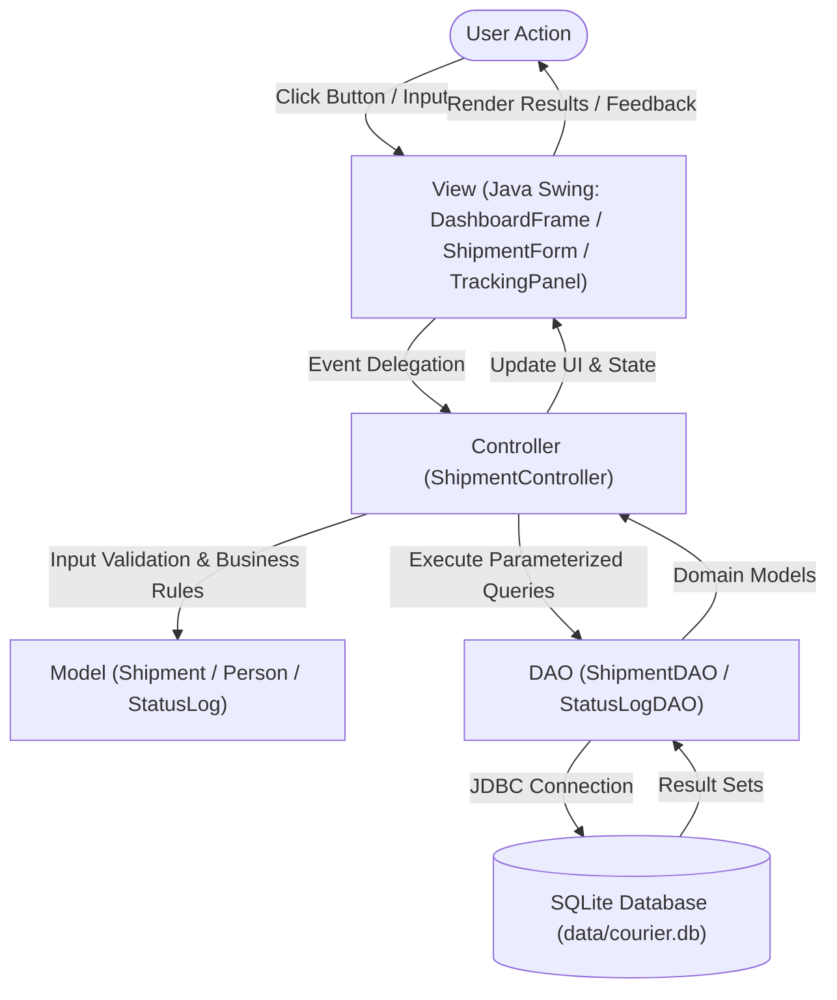

# 📦 Courier and Parcel Tracking System

A complete desktop-based **Courier and Parcel Tracking System** built with **Java (JDK 17/21)**, **Java Swing**, and **SQLite via JDBC**, strictly adhering to the **Model–View–Controller (MVC)** architectural design pattern.

---

## 1. Technology Stack

| Requirement | Implementation | Purpose |
| :--- | :--- | :--- |
| **Programming Language** | Java (JDK 17 or 21) | Core application logic and object-oriented programming |
| **GUI Framework** | Java Swing & FlatLaf | Desktop windows, forms, tables, dashboard widgets, and custom renderers |
| **Database** | SQLite (`data/courier.db`) | Relational database stored locally, created automatically on first run |
| **Database Connectivity** | JDBC (`sqlite-jdbc` 3.45.1.0) | Direct communication between Java and SQLite |
| **Design Pattern** | **MVC (Model–View–Controller)** | Separation of domain models, user interface, business logic, and database layer |
| **SQL Handling** | Prepared Statements (`PreparedStatement`) | Parameterized queries for secure, injection-safe CRUD operations |
| **Build & Dependencies** | Apache Maven | Dependency management, compiler, and shaded executable JAR build |
| **Execution** | Locally on a computer | Standalone desktop application; no web hosting or public deployment required |
| **Testing** | JUnit 5 (`junit-jupiter`) | Automated unit tests for controller validation, state machine, and data flow |

---

## 2. MVC Architecture & Folder Structure

The project strictly follows the standard Maven layout organized by MVC layers:

```text
CourierParcelTracking/
├── pom.xml                                    # Maven configuration and dependencies
├── README.md                                  # Complete project documentation
│
├── data/
│   └── courier.db                             # Local SQLite database file (created automatically)
│
├── src/
│   ├── main/
│   │   ├── java/
│   │   │   └── com/
│   │   │       └── courier/
│   │   │           ├── Main.java              # Entry point: Wires MVC components and launches GUI
│   │   │           │
│   │   │           ├── model/                 # [MODEL LAYER] Domain objects and status enumeration
│   │   │           │   ├── Shipment.java      # Parcel shipment entity
│   │   │           │   ├── Person.java        # Sender and Receiver data model
│   │   │           │   ├── StatusLog.java     # Chronological tracking history record
│   │   │           │   └── ShipmentStatus.java# Status enum (DISPATCHED, IN_TRANSIT, DELIVERED, etc.)
│   │   │           │
│   │   │           ├── view/                  # [VIEW LAYER] Java Swing presentation components
│   │   │           │   ├── DashboardFrame.java# Main application window (Dashboard & Table)
│   │   │           │   ├── ShipmentForm.java  # Dispatch input form with live ETA preview
│   │   │           │   ├── TrackingPanel.java # Visual tracker & 4-stage progress stepper
│   │   │           │   └── UITheme.java       # Visual styles, color palette, and badge renderers
│   │   │           │
│   │   │           ├── controller/            # [CONTROLLER LAYER] Business logic & event coordination
│   │   │           │   └── ShipmentController.java # Validates input and coordinates requests
│   │   │           │
│   │   │           ├── dao/                   # [DAO LAYER] JDBC Data Access Objects
│   │   │           │   ├── ShipmentDAO.java   # Parameterized SQL queries for shipments
│   │   │           │   └── StatusLogDAO.java  # SQL queries for audit history logs
│   │   │           │
│   │   │           ├── database/              # [DATABASE LAYER] Connection & directory management
│   │   │           │   └── DatabaseManager.java# SQLite JDBC connection & schema initializer
│   │   │           │
│   │   │           └── util/                  # [UTILITY LAYER]
│   │   │               └── TrackingNumberGenerator.java # Generates unique tracking IDs
│   │   │
│   │   └── resources/
│   │       └── icons/
│   │           └── README.md                  # Optional GUI icon assets
│   │
│   └── test/
│       └── java/
│           └── com/
│               └── courier/
│                   ├── ShipmentControllerTest.java # JUnit 5 test suite for MVC Controller
│                   └── ShipmentServiceTest.java    # JUnit 5 test suite for business operations
```

### MVC Responsibility Breakdown

| MVC Component | Files | Responsibility |
| :--- | :--- | :--- |
| **Model** | `Shipment.java`, `Person.java`, `StatusLog.java`, `ShipmentStatus.java` | Represents shipment data, sender/receiver details, and status enumeration. |
| **View** | `DashboardFrame.java`, `ShipmentForm.java`, `TrackingPanel.java`, `UITheme.java` | Displays the graphical user interface, renders status badges and steppers, and accepts user input. **Does not execute SQL directly.** |
| **Controller** | `ShipmentController.java` | Handles GUI events, performs input validation, enforces state transition rules, coordinates with the DAO, and updates the View. |
| **Database Layer (DAO)** | `ShipmentDAO.java`, `StatusLogDAO.java`, `DatabaseManager.java` | Manages the SQLite database connection (`courier.db`) and executes parameterized SQL statements using JDBC. |
| **Entry Point** | `Main.java` | Initializes the database, wires the DAO, Controller, and View layers together, and launches the application on the Swing Event Dispatch Thread (EDT). |

---

## 3. How the Application Works (MVC Flow)



### Example: Adding a New Shipment
1. **View (`ShipmentForm.java`):** User fills in sender, receiver, parcel details, and clicks **"Dispatch & Save Shipment"**.
2. **Controller (`ShipmentController.java`):** 
   - Intercepts the submit action.
   - Validates required fields (sender/receiver names, phone numbers, addresses, positive weight).
   - Generates a unique tracking number (`CTS-YYYYMMDD-XXXXXX`).
   - Computes estimated delivery date based on service type.
3. **Model + DAO (`ShipmentDAO.java`, `StatusLogDAO.java`):**
   - Populates the `Shipment` and initial `StatusLog` models.
   - Executes parameterized `INSERT` statements using SQLite JDBC.
4. **SQLite Database (`data/courier.db`):** 
   - Persists the record safely inside the writable `data/` directory.
5. **Controller ➔ View:** 
   - Controller notifies `DashboardFrame` to update the shipment table, recalculate dashboard statistics, and show a confirmation dialog with the assigned tracking number.

---

## 4. Database Schema (`data/courier.db`)

The SQLite database file `data/courier.db` is **automatically created** upon initial application launch.

### 1. `shipments` Table
```sql
CREATE TABLE IF NOT EXISTS shipments (
  id                  INTEGER PRIMARY KEY AUTOINCREMENT,
  tracking_number     TEXT    NOT NULL UNIQUE,
  status              TEXT    NOT NULL DEFAULT 'DISPATCHED',
  service_type        TEXT    NOT NULL DEFAULT 'Standard',
  parcel_description  TEXT,
  parcel_category     TEXT,
  weight_kg           REAL    DEFAULT 0.0,
  declared_value      REAL    DEFAULT 0.0,
  is_fragile          INTEGER DEFAULT 0,
  current_location    TEXT,
  remarks             TEXT,
  dispatch_date       TEXT    NOT NULL,
  estimated_delivery  TEXT,
  last_updated        TEXT    NOT NULL,
  sender_name         TEXT    NOT NULL,
  sender_address      TEXT,
  sender_city         TEXT,
  sender_state        TEXT,
  sender_pincode      TEXT,
  sender_phone        TEXT    NOT NULL,
  sender_email        TEXT,
  receiver_name       TEXT    NOT NULL,
  receiver_address    TEXT,
  receiver_city       TEXT,
  receiver_state      TEXT,
  receiver_pincode    TEXT,
  receiver_phone      TEXT    NOT NULL,
  receiver_email      TEXT
);
```

### 2. `status_logs` Table
```sql
CREATE TABLE IF NOT EXISTS status_logs (
  id              INTEGER PRIMARY KEY AUTOINCREMENT,
  tracking_number TEXT    NOT NULL,
  status          TEXT    NOT NULL,
  location        TEXT,
  remarks         TEXT,
  updated_by      TEXT    DEFAULT 'System',
  timestamp       TEXT    NOT NULL,
  FOREIGN KEY (tracking_number) REFERENCES shipments(tracking_number)
);
```

> **Seed Data:** On the first run, the database is automatically populated with 4 realistic demo parcels (Electronics, Legal Documents, Medicine, Clothing) across different statuses (`Delivered`, `In-Transit`, `Out for Delivery`, `Dispatched`) and chronological tracking logs, so the dashboard displays live metrics immediately.

---

## 5. How to Build and Run

### Prerequisites
- **Java (JDK 17 or JDK 21)** installed and added to `PATH`. Verify with:
  ```bash
  java -version
  ```
- **Apache Maven 3.8+** installed. Verify with:
  ```bash
  mvn -version
  ```

---

### Method 1: Run with Maven (Fastest)

1. Open a terminal in the project root directory:
   ```bash
   mvn clean compile
   ```
2. Launch the desktop GUI:
   ```bash
   mvn exec:java -Dexec.mainClass="com.courier.Main"
   ```

---

### Method 2: Build and Run Standalone Fat JAR

1. Package the project into a self-contained executable JAR:
   ```bash
   mvn clean package
   ```
2. Run the generated JAR:
   ```bash
   java -jar target/CourierParcelTracking.jar
   ```

---

### Method 3: In an IDE (IntelliJ IDEA / Eclipse / NetBeans)

1. **IntelliJ IDEA:**
   - File ➔ Open ➔ Select `CourierParcelTracking`.
   - Wait for Maven dependency sync to finish.
   - Navigate to `src/main/java/com/courier/Main.java`.
   - Right-click and select **Run 'Main.main()'**.

2. **Eclipse IDE:**
   - File ➔ Import ➔ Existing Maven Projects ➔ Browse to folder ➔ Finish.
   - Right-click `Main.java` ➔ Run As ➔ Java Application.

3. **Apache NetBeans:**
   - File ➔ Open Project ➔ Select project folder.
   - Click **Run Project** or right-click `Main.java` ➔ Run File.

---

### Running Automated Unit Tests
```bash
mvn test
```

---

## 6. Important Implementation Decisions

1. **Java Swing Desktop Application:** Modern desktop GUI with tabbed navigation, live digital clock, metric stat cards, and status badge pill styling.
2. **SQLite + JDBC:** Self-contained database requiring no external database server setup or root credentials. The database file is located at `data/courier.db`.
3. **Strict MVC Pattern:** All button clicks and user events are routed from Views to `ShipmentController.java`. Views never perform SQL operations.
4. **State Transition Rules:** Business logic prevents illogical transitions (e.g., delivered parcels cannot transition back to in-transit; returned parcels cannot be updated).
5. **Unique Tracking Numbers:** Generates formatted, collision-resistant tracking codes (`CTS-YYYYMMDD-XXXXXX`).
6. **Delivery Services & Dynamic ETA:** Calculates accurate delivery dates for Same-Day, Overnight, Express, Standard, and International service types.